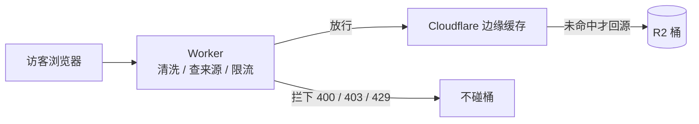

# PostPic Firewall

给 Cloudflare R2 图床加一道门卫：挡住外站盗链、目录扫描和恶意刷量，顺便把带宽费压到 0。

An R2 firewall on Cloudflare Workers. Clean the request, then read one exact key from the bucket.



## 它拦什么

| 有人想干的事 | 门卫怎么处理 |
| --- | --- |
| 把你的图贴到自己网站 | 看请求来自哪个页面，站外一律拒绝 |
| 猜 `image-1.png`、`image-2.png` 一直猜下去 | 每 IP 每分钟最多认 600 个"新图"，猜多了就拒 |
| 疯狂重复请求同一张图 | 边缘缓存只回源一次，之后不再产生 R2 费用 |
| 用 `../`、`%2e%2e`、`%2f` 爬出目录 | 地址解不干净就拒绝，绝不"猜"路径 |
| 用 PUT / DELETE 改桶里的东西 | 只放行 GET / HEAD / OPTIONS，写操作到不了桶 |
| 上传一个 html 借你的域名做坏事 | 类型只按扩展名判断，忽略桶里存的声明 |

## 部署（大约 5 分钟）

> 为什么不直接放一个"一键部署"按钮？因为 `wrangler.jsonc` 是本仓库作者自己的线上配置（桶名、域名都是他的），直接点部署会在"桶不存在"这一步失败。先 Fork 改成你自己的，再点部署，一次就能成。

### 1. 先有一个 R2 桶

Cloudflare 后台 → **R2** → **Create bucket**，把图片传进去。记住桶名。

### 2. Fork 这个仓库

点右上角 **Fork**。后面的修改都在你自己的仓库里做，这样点部署按钮时用的是你的配置。

### 3. 改三处

在 GitHub 网页上打开 `wrangler.jsonc`，点铅笔图标，改这三处就行：

**① 桶名**

```diff
- "bucket_name": "postpic"
+ "bucket_name": "你的桶名"
```

**② 域名** —— 第一次部署建议先整段删掉，用 Cloudflare 送的 `xxx.workers.dev` 测试。跑通之后再回来填自己的域名。

```diff
- "routes": [
-   {
-     "pattern": "postpic.iicemeta.com",
-     "custom_domain": true
-   }
- ],
+ // 第一次部署先留空，成功后在后台 Workers → Settings → Domains & Routes 里绑定
```

**③ 允许谁引用你的图** —— 填你博客的域名（子域会自动包含，用英文逗号分隔）

```diff
- "ALLOWED_REFERER_HOSTS": "www.iicemeta.com,iicemeta.com,postpic.iicemeta.com",
- "ALLOWED_ORIGIN_HOSTS": "www.iicemeta.com,iicemeta.com,postpic.iicemeta.com",
+ "ALLOWED_REFERER_HOSTS": "你的博客.com",
+ "ALLOWED_ORIGIN_HOSTS": "你的博客.com",
```

顺手可以把占位页文案改成自己的（就在下面几行）：

```jsonc
"SITE_NAME": "PostPic",                       // 页面大标题
"SITE_TAGLINE": "我的图片资源服务器",           // 副标题，留空不显示
"BLOG_URL": "https://你的博客.com",            // 按钮链接，留空不显示按钮
```

### 4. 部署

把这个地址里的用户名换成你自己的，然后在浏览器里打开：

```
https://deploy.workers.cloudflare.com/?url=https://github.com/你的用户名/postpic-firewall
```

登录 Cloudflare → 确认 → 等 1 分钟。部署完成后会给你一个 `https://xxx.workers.dev` 地址。

### 5. 看看成不成

```bash
curl -I https://xxx.workers.dev/你的图片.jpg
```

响应头里出现 `X-Firewall: postpic-firewall/1` 就说明门卫在岗。再打开 `https://xxx.workers.dev/` 应该看到一张说明页，而不是 404。

## 出问题了看这里

拦截时响应头里有一个 `X-Firewall-Block`，告诉你卡在哪一步：

| 看到这个 | 意思 | 怎么改 |
| --- | --- | --- |
| `hotlink` | 请求来自站外 | 把博客域名加进 `ALLOWED_REFERER_HOSTS` |
| `extension_not_allowed` | 文件类型不在白名单 | 把扩展名加进 `ALLOWED_EXTENSIONS` |
| `dotfile` | 路径里有 `.` 开头的段 | 正常情况不该出现，别放行 |
| `novelty_quota` | 一分钟内看的"新图"太多 | 阈值调大 `NOVELTY_MAX_KEYS` |
| `rate_limited` | 请求太密 | 调大 `RATE_LIMIT_RPS` / `RATE_LIMIT_BURST` |

**改了配置不生效？** 重启一次部署（改完 `wrangler.jsonc` 再 push 一次，或在后台点重新部署）。

**博客一篇文章 50 张图，怕被自己限流？** 默认参数是按"首屏 50 张冷图"算过的，不用动。真要调，`RATE_LIMIT_BURST` 至少要是"图片数 × 4"。

**桶里没有扩展名的文件取不到？** 把 `ENFORCE_EXTENSION` 留成 `false`，或者给文件加上扩展名。

**门卫会被绕过去吗？** 只要 R2 桶自己不再挂自定义域、也不开 `r2.dev`，公网就只剩 Worker 这一条路。这是整套方案的前提，千万别两边同时开。

<details>
<summary>进阶：环境变量速查</summary>

全部写在 `wrangler.jsonc` 的 `vars` 里，每个都有注释。常用的几个：

| 变量 | 默认 | 作用 |
| --- | --- | --- |
| `ALLOWED_REFERER_HOSTS` | — | 允许引用图片的站点，子域自动放行 |
| `ALLOWED_EXTENSIONS` | 图片/视频/字体等 30 多种 | 允许访问的文件类型，留空=不限制 |
| `RATE_LIMIT_BURST` / `RATE_LIMIT_RPS` | `800` / `40` | 瞬时并发 / 每秒回填速率 |
| `NOVELTY_MAX_KEYS` | `600` | 每分钟允许出现的"不同图片"数量，挡扫描的关键 |
| `CDN_CACHE_SECONDS` | `3600` | 图片缓存时长。文件名带内容 hash 才能调大 |
| `IMMUTABLE` | `false` | 文件名永不变时打开，配合超长缓存 |
| `URL_SIGNING_SECRET` | 未设置 | 设置后所有图片必须带签名链接，最狠的一层 |

`URL_SIGNING_SECRET` 不是变量是 secret，用 `npx wrangler secret put URL_SIGNING_SECRET` 设置。开启前想清楚：它会把每张图变成"有有效期的链接"（最长 30 天），静态博客里的老文章会过期变空图，通常只在被人恶意刷的时候临时打开。

本地开发：

```bash
npm install
npm run dev        # 本地起服务
npm run typecheck  # 类型检查
bash scripts/smoke.sh  # 38 项回归用例
```

</details>

## 许可证

[MIT](LICENSE)
